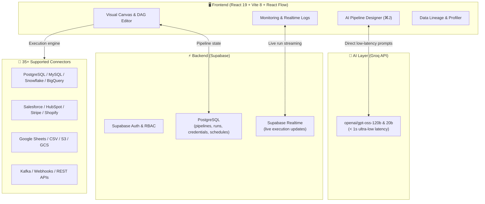

<div align="center">
  <h1>⚡ FlowForge</h1>
  <p><strong>The Visual All-in-One Data Engineering Platform</strong></p>
  <p>Replaces Airflow, dbt, Fivetran, and Great Expectations with a unified, AI-powered drag-and-drop workspace.</p>

  <a href="https://flowforge-gold.vercel.app">
    
  </a>
  
  
  
  
</div>

---

## 🌟 Highlights & Capabilities

- 🤖 **AI Pipeline Designer (`⌘J`)**: Build complex multi-node visual DAGs from natural language prompts using Groq inference.
- 🎨 **Visual Canvas**: 60+ node types across Sources, Transformations, Destinations, and Control Flow powered by `@xyflow/react`.
- ⚡ **Complete Transform Engine**: In-browser execution for Joins, Group By + Aggregations, Null Handling, Type Casting, Window Functions, and Slowly Changing Dimensions (SCD Types 0–6).
- 🧠 **AI Transform & Custom Code**: Describe transformations in plain English to generate validated JavaScript arrow functions, or write custom JavaScript and SQL.
- 🔗 **Data Lineage**: Interactive table-level and column-level DAG visualization with upstream/downstream dependency tracing.
- 🛡️ **Data Quality & Profiler**: Automatic null %, cardinality, min/max metrics, and 0–100 Data Quality Health Scores.
- 📄 **GitOps YAML Export / Import**: Declarative round-trip YAML pipeline definitions ready for version control.
- ⏱️ **SLA & Realtime Monitoring**: Live run execution streaming via Supabase Realtime with SLA breach indicators and KPI metrics.
- 🔒 **Enterprise Secrets Manager**: Centralized, encrypted secret storage with `{{ secrets.NAME }}` template injection.
- 🛍️ **Marketplace & Templates**: 1-click cloneable pipelines for Salesforce, Shopify, Stripe, GA4, BigQuery, and Snowflake.

---

## 🏗️ Architecture



---

## ⌨️ Keyboard Shortcuts

| Shortcut | Action |
|---|---|
| `⌘ + J` / `Ctrl + J` | Open AI Pipeline Designer |
| `⌘ + Z` / `Ctrl + Z` | Undo canvas change |
| `⌘ + Shift + Z` / `Ctrl + Y` | Redo canvas change |
| `Backspace` / `Delete` | Remove selected node |
| `Space + Drag` | Pan canvas |
| `?` | Open Keyboard Shortcuts Cheat Sheet |

---

## 🚀 Getting Started

### Prerequisites
- Node.js 20+
- Free Supabase project ([supabase.com](https://supabase.com))
- Free Groq API key ([console.groq.com](https://console.groq.com))

### Installation

```bash
# Clone the repository
git clone https://github.com/piyushzore/flowforge.git
cd flowforge

# Install dependencies
npm install

# Configure environment variables
cp .env.example .env
```

### Environment Configuration (`.env`)

```env
VITE_SUPABASE_URL=https://your-project.supabase.co
VITE_SUPABASE_ANON_KEY=your-supabase-anon-key
VITE_GROQ_API_KEY=your-groq-api-key # Optional: can also be configured in-app
```

### Running Locally

```bash
npm run dev
```

Open [http://localhost:5173](http://localhost:5173) in your browser.

---

## 📜 Database Migrations

Apply the migration in `supabase/migrations/20261019_credentials_and_runs.sql` to your Supabase project to enable persistent credentials, pipeline runs, and schedules with Row Level Security (RLS).

---

## 📄 License

MIT License. Built with passion for data engineers.
