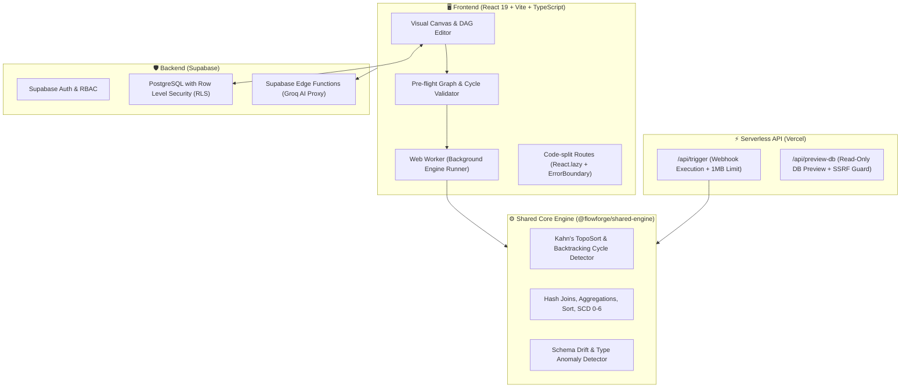

<div align="center">
  <h1>⚡ FlowForge</h1>
  <p><strong>Visual Data Pipeline Studio</strong></p>
  <p>A drag-and-drop workspace for designing, testing, and running data pipelines in React 19 and TypeScript.</p>

  <a href="https://flowforge-gold.vercel.app">
    
  </a>
  
  
  
  
</div>

---

> ⚠️ **Development Status**: FlowForge is a lightweight visual data pipeline builder designed for web developers and data teams. Please refer to the **Feature Status Matrix** below for what is production-ready, what is simulated/demo, and what is currently in development.

---

## 📊 Feature Status Matrix

| Capability | Status | Implementation Details |
|---|---|---|
| **Visual DAG Canvas** | ✅ **Real** | Interactive React Flow canvas (`@xyflow/react`) with drag-and-drop node placement. |
| **Transform Engine** | ✅ **Real** | Portable, zero-DOM shared engine (`@flowforge/shared-engine`) running Joins, Aggregations, Sort, Dedup, Filter, and SCD Types 0–6 with 65+ automated tests. |
| **Cycle Detection** | ✅ **Real** | Kahn's algorithm + DFS backtracking detects cycles before execution, highlights offending edges, and blocks run. |
| **CSV / Excel Parsing** | ✅ **Real** | Full dataset parsing via PapaParse and XLSX; automatic header sanitization for duplicate (`col_2`) and empty (`column_1`) headers. |
| **Webhook Execution (`/api/trigger`)** | ✅ **Real** | Serverless REST endpoint loads pipeline definition, checks SHA-256 token hash, enforces 1 MB limit, reports actual latency, and runs identical shared engine. |
| **Database Preview (`/api/preview-db`)** | ✅ **Real (PostgreSQL / MySQL)** | Read-only connection preview with strict query parsing (SELECT-only) and SSRF protection (private IP / AWS metadata blocking). |
| **CSV Injection Protection** | ✅ **Real** | Escapes formula cells starting with `=`, `+`, `-`, `@`, `\t`, `\r` when exporting CSV files. |
| **YAML Export & Import** | ✅ **Real** | Round-trip YAML generation with 100 KB size limit and arbitrary code sanitization (`/* BLOCKED: ... */`). |
| **AI Features** | 🔶 **Server-Side Edge Functions** | Routed through Supabase Edge Functions (`generate-pipeline`, `ai-transform`, `explain-error`). No API keys stored in browser client or localStorage. |
| **Database Connectors (Snowflake, BigQuery, Kafka, Salesforce)** | 🚧 **Coming Soon** | Clearly labeled as "Coming Soon" and disabled in UI; not faking live connections. |
| **Credentials Encryption Vault** | 🚧 **Schema Ready (Demo storage)** | Schema migration prepared in `supabase/migrations/20261101_vault_encryption.sql`; client currently notifies user with demo warning. |

---

## 🏗️ Architecture



---

## 🔒 Security Model

1. **Zero Client Secrets**: No external third-party API keys (e.g. `VITE_GROQ_API_KEY`) exist in client code, client bundles, or browser `localStorage`.
2. **SSRF Defense**: The database preview proxy automatically resolves DNS hostnames and verifies they do not fall within private IPv4 subnets (RFC 1918), loopback (`127.0.0.1`), or cloud metadata IPs (`169.254.169.254`).
3. **Multi-Tenant RLS**: Row Level Security ensures complete tenant isolation between organizations across pipelines, credentials, execution runs, and logs.
4. **Formula Injection Defense**: CSV exports prepend a single quote (`'`) to cell contents beginning with formula triggers (`=`, `+`, `-`, `@`).
5. **Strict HTTP Headers**: Production deployments via `vercel.json` enforce Content-Security-Policy, `X-Frame-Options: DENY`, and `X-Content-Type-Options: nosniff`.

---

## 🚀 Getting Started

### Prerequisites
- Node.js 20+
- Free Supabase project ([supabase.com](https://supabase.com))

### Installation

```bash
# Clone the repository
git clone https://github.com/piyushzore/flowforge.git
cd flowforge

# Install dependencies
npm install

# Configure environment variables
cp .env.example .env
```

### Environment Variables (`.env`)

```env
# Client-accessible (Supabase URL & Publishable Anon Key)
VITE_SUPABASE_URL=https://your-project.supabase.co
VITE_SUPABASE_ANON_KEY=your-anon-key-here

# Server-only (Required for Serverless /api/trigger and Supabase Edge Functions)
SUPABASE_URL=https://your-project.supabase.co
SUPABASE_SERVICE_ROLE_KEY=your-service-role-key-here
GROQ_API_KEY=your-groq-key-here
```

### Running Locally

```bash
npm run dev
```

### Running Test Suite

```bash
npm test
```

---

## 📜 Database Migrations

Apply database migrations in sequence to your Supabase PostgreSQL instance:

1. `supabase/migrations/20260722_rls_policies.sql` — Base organization and user row-level security.
2. `supabase/migrations/20260722_fix_rls_circular.sql` — Security definer function resolving circular RLS dependency.
3. `supabase/migrations/20261019_credentials_and_runs.sql` — Pipeline run history, run logs, credentials, and schedules.
4. `supabase/migrations/20261101_vault_encryption.sql` — Server-side pgcrypto vault encryption schema and secret resolution.

---

## ⚠️ Known Limitations

- **Complex SQL Queries**: Database previews currently support `SELECT` and `WITH ... SELECT` read queries. Multi-statement queries and procedural transactions are disallowed.
- **Enterprise Warehouses**: Direct connections to Snowflake, Google BigQuery, and Databricks are under development and currently labeled as "Coming Soon".
- **Real-Time Schedules**: Schedules are saved and managed via the UI; automated cron execution requires a server-side runner or external cron service trigger.

---

## 📄 License

MIT License. See [LICENSE](LICENSE) for details.
